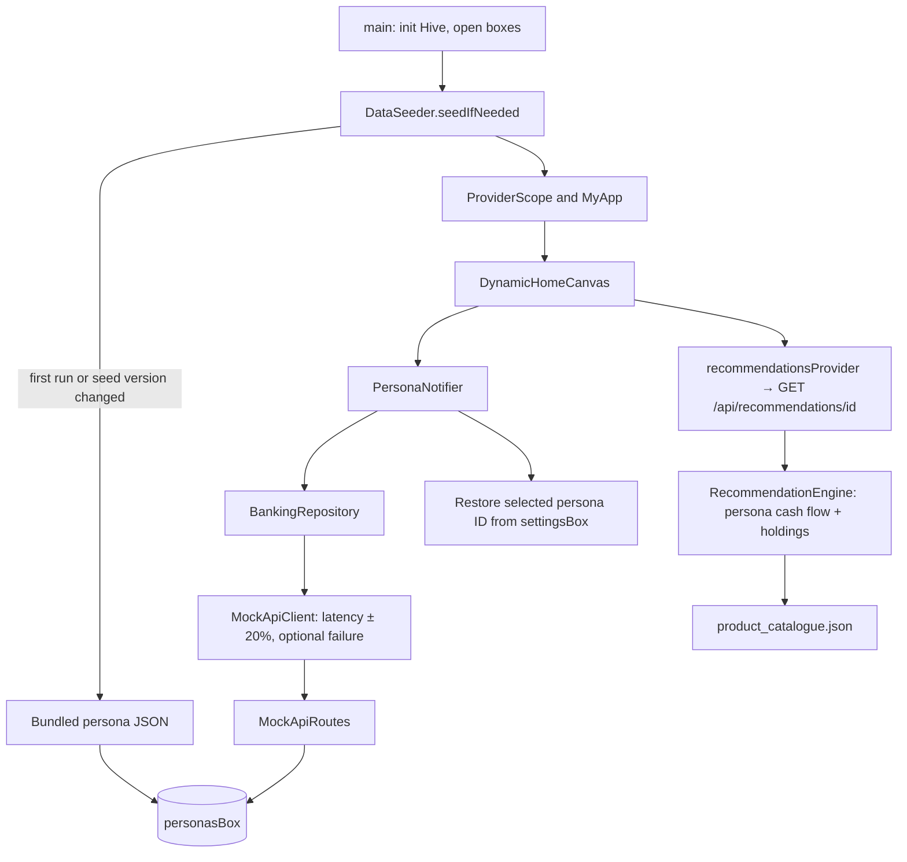
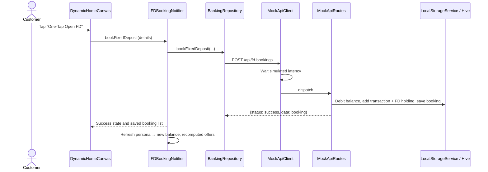

# Personalized Banking POC

A Flutter/Riverpod proof of concept for a contextual banking home screen. Persona
data ships as JSON, is copied into Hive on first run, and is served from Hive
through in-process mock API routes with simulated network latency. Hive also
persists the selected persona, fixed-deposit (FD) bookings and demo settings.

See `DEMO.md` for the presenter's script and `PLAN.md` for the plan and what was built
differently. Steps 1-7 are done: data in Hive, simulated latency,
computed offers, the demo panel and reset, the chat engine and the chat screen.

> **Mock API clarification:** `lib/routes/mock_api_routes.dart` dispatches route
> strings to Dart functions in the app. It is not an HTTP server and does not
> listen on a network port. To use a real backend, implement `ApiClient` with an
> HTTP client and keep the endpoint paths and response shapes aligned.

## Run and verify

```shell
flutter pub get
flutter run
flutter analyze
flutter test --coverage
```

Requires Dart 3.11+ (Flutter 3.41+). On Windows, `flutter pub get` for a
plugin project needs Developer Mode enabled (symlink support).

## UI templates

Set the demo currency and appearance together in `lib/core/demo_config.dart`.
For example, change `selectedDemoCurrency` to `DemoCurrency.usd` and
`selectedDemoTemplate` to `DemoTemplate.light` (white backgrounds with blue
outlines and hover highlights). Currency options and UI templates are defined
in their respective `demo_currency.dart` and `demo_template.dart` files. These
settings do not change banking actions or chat behavior.

## Demo sign-in

The welcome screen signs into the persona associated with the configured email
and password in `lib/core/demo_config.dart`:

| Persona | Email | Password |
|---|---|---|
| Ananya Sharma | `ananya.sharma@gmail.com` | `ananya123` |
| Rajesh Traders | `rajesh.traders@gmail.com` | `rajesh123` |

These are mock, client-side demo credentials, not secure authentication. Update
an account's `personaId` in the same file to map credentials to a different
persona. The demo MPIN for approving chat actions is configured there as
`demoMpin` (default: `1234`). The app verifies it before any action runs; a
wrong MPIN fails and cancels that action. These client-side checks are only for
the mock demo, not production authentication.

## Runtime flow



### FD booking flow



## Hive storage

| Box | Contents |
|---|---|
| `settingsBox` | `selected_persona_id`, `seed_version`, `persona_ids` (display order), `latency_ms`, `simulate_failure` |
| `personasBox` | personaId → persona record (JSON string), seeded from `lib/mock_data/*_persona.json`. Write routes update its balance, `recentTransactions` and `holdings` (FDs, credit lines, loans). |
| `transactionsBox` | bookingId → FD booking map |
| `chatBox` | personaId → conversation JSON (`messages` and the `pending` task), one per persona |

`DataSeeder.reseed()` clears `personasBox`, `transactionsBox` and the selection,
then restores the JSON baseline. Latency and failure settings are kept. Bump
`kSeedVersion` in `lib/data/data_seeder.dart` whenever the persona JSON shape
changes so installed demos reseed.

## Mock API routes

All responses use the envelope `{ "status": "success", "data": ... }`. Errors
are thrown as `MockApiException` (`lib/core/exceptions.dart`) with a `code`
and HTTP-like `statusCode`.

| Method | Path | Purpose and response data |
|---|---|---|
| `GET` | `/api/personas` | All persona records from Hive, in display order. Each has `persona`, `financialSummary`, `contextualTriggers`, `spendByCategory`, `recentTransactions`, `holdings`, `goals`. |
| `GET` | `/api/personas/{id}` | One persona record. Unknown ID → `NOT_FOUND` (404). |
| `GET` | `/api/personas/{id}/transactions` | The persona's `recentTransactions`. |
| `GET` | `/api/recommendations/{personaId}` | Computed by `RecommendationEngine` from the persona's surplus/deficit and holdings, using `product_catalogue.json`. |
| `POST` | `/api/chat` | Body `{personaId, message, pending?}`. Returns a `ChatReply` (`text`, `intent`, optional confirmation `action`, `pending` state for the next turn, `suggestions` chips, and `execute` when the customer just confirmed a card). |
| `POST` | `/api/payments` | Body `{personaId, payee, amount, category}`. Debits the balance (an active overdraft can take it below zero) and logs a transaction. Too much → `INSUFFICIENT_FUNDS` (422). |
| `POST` | `/api/cards/lock` | Body `{personaId}`. Locks the card; again → `ALREADY_LOCKED` (409). |
| `GET` | `/api/fd-bookings?personaId=` | Stored FD bookings, optionally for one persona. |
| `POST` | `/api/fd-bookings` | Validates the body, debits the balance, records a transaction and FD holding, stores and returns the booking (with simple-interest maturity). Invalid body → `BAD_REQUEST` (400); amount above balance → `INSUFFICIENT_FUNDS` (422). |
| `POST` | `/api/credit-lines` | Body `{personaId, productType: CREDIT_LINE \| PERSONAL_LOAN, amount, interestRate, tenorMonths}`. Adds the holding; a loan is also credited to the balance. Already held → `ALREADY_ACTIVE` (409). |

Chat replies are delayed by 0.8-1.5 s (the assistant "thinking") even on a fast network;
a slower simulated network wins, and latency 0 turns the delay off.

Other paths → `NOT_FOUND`; methods other than GET/POST → `METHOD_NOT_ALLOWED` (405).
With "simulate failure" on, every call throws `NETWORK_UNAVAILABLE` (503).

Example FD request body:

```json
{
  "personaId": "p_salaried_01",
  "depositAmount": 150000,
  "tenorMonths": 12,
  "interestRate": 7.2,
  "payoutOption": "AT_MATURITY",
  "autoRenew": true
}
```

## AI chat (mock)

`RuleBasedChatEngine` implements the `ChatEngine` interface (`lib/chat/chat_engine.dart`),
so an LLM-backed engine can replace it without touching routes, notifiers or UI. The
engine is stateless: multi-step tasks are carried by `ChatPending`, which the client
sends back with the next message.

| Stage | File | What it does |
|---|---|---|
| Intent | `intent_classifier.dart` | Weighted keyword rules per intent; highest score at or above 3 wins, else fallback. |
| Slots | `slot_extractor.dart` | Amounts (`1.5 lakh`, `50k`, `₹1,50,000`) and tenors (`12 months`, `2 yrs`, a bare `12` when asked). |
| Dialog | `rule_based_chat_engine.dart` | Per-intent handlers, slot filling, guard rails, confirmation cards. |
| Wording | `response_composer.dart` | All customer-facing text, built from the persona's cash flow, spend and holdings. |

Intents: greeting, thanks, help, check balance, spend insight (overall or one category),
recommend, create FD, need credit, pay bill, lock card.

- **FD:** missing amount/tenor are asked for (with chips). The amount is capped at balance minus the safety buffer. Rate, tenors and payout come from the live offer, or the segment's catalogue product.
- **Credit:** a deficit plus an offer produces an activation card; once the product is held the assistant says so instead.
- **Payments:** payee and the usual amount come from the persona's last debit in that category (rent, payroll, utilities, GST). If the amount exceeds balance plus any overdraft, the assistant offers the overdraft instead.
- **Cards:** every task ends in a confirmation card; replying "yes" returns `execute`, and the client runs the matching route (`/api/fd-bookings`, `/api/credit-lines`, `/api/payments`, `/api/cards/lock`).

## Chat screen

Open it with the **Ask AI** button on the home screen, or by tapping a quick-action tile
(the tile's `prompt` is sent straight away). The assistant greets first; its replies come with
quick-reply chips, and every task ends in a confirmation card.

- **Confirm / Cancel** on a card send "Yes, go ahead" / "No, cancel", so the transcript reads like a normal chat.
- On confirmation `ChatNotifier` carries the task out through the same code the home screen uses (`FDBookingNotifier`, `CreditLineNotifier`) or the payment / card-lock routes, then refreshes the persona so balance, offers and the card status update everywhere.
- A card moves through *awaiting you → working → done / failed*, or *cancelled* when declined or replaced by a newer proposal.
- A network error becomes an error bubble with a **Try again** chip that resends the last message (or the greeting).
- History and any half-finished task are saved per persona, so a conversation survives a restart. **Reset Demo to Baseline** clears them.

## File guide

| File | Responsibility |
|---|---|
| `lib/main.dart` | Initialises Hive, seeds data if needed, starts the app. |
| `lib/core/exceptions.dart` | `MockApiException` and `describeError` for customer-facing messages. |
| `lib/core/format.dart` | `formatInr`: Indian rupee grouping (₹1,85,000). |
| `lib/data/hive_storage.dart` | `LocalStorageService`: box names, persona records, selection, bookings, demo settings, demo-data reset. |
| `lib/data/data_seeder.dart` | Copies persona JSON assets into Hive; `seedIfNeeded` / `reseed`. |
| `lib/data/api_client.dart` | `ApiClient` interface (swap for HTTP later). |
| `lib/data/mock_api_client.dart` | `ApiClient` over `MockApiRoutes` with jittered latency and failure injection. |
| `lib/data/banking_repository.dart` | Turns API envelopes into domain models. |
| `lib/routes/mock_api_routes.dart` | Endpoint constants and the in-process route dispatcher. |
| `lib/domain/models.dart` | Persona, financial summary (surplus/deficit), spend, transactions, holdings, goals, recommendations. |
| `lib/domain/fixed_deposit.dart` | FD application model, payout parsing (`AT_MATURITY` / `atMaturity`) and maturity calculation. |
| `lib/chat/*.dart` | The chat engine, see "AI chat (mock)" above. `chat_models.dart` holds `ChatReply`, `ChatAction`, `ChatPending` and their JSON; `chat_message.dart` holds the saved `ChatMessage` and the screen's `ChatState`. |
| `lib/state/chat_notifier.dart` | One conversation per persona: sends messages, keeps `pending`, runs confirmed tasks, saves history. |
| `lib/screens/chat_screen.dart` | The chat page; wires `ChatView` to the notifier. |
| `lib/widgets/chat_view.dart`, `chat_action_card.dart` | Bubbles, typing indicator, chips, input and the confirmation card. Presentational, so they are tested without any providers. |
| `lib/domain/credit_line.dart` | Activated overdraft line or personal loan. |
| `lib/domain/recommendation_engine.dart` | Catalogue-driven offers: surplus → FD (share of surplus, rounded), deficit → overdraft/loan (gap + buffer) unless already held. |
| `lib/domain/demo_settings.dart` | Latency / failure settings. |
| `lib/domain/mock_persona_datasets.dart` | Fallback personas shown while Hive data loads. |
| `lib/state/providers.dart` | Riverpod providers for storage, seeder, routes, API client, repository, demo settings. Override in tests. |
| `lib/state/persona_notifier.dart` | Persona list/selection and `recommendationsProvider`. |
| `lib/state/booking_notifier.dart` | FD booking state, saved bookings, and `personaBookingsProvider` (selected persona only). |
| `lib/state/credit_line_notifier.dart` | Activates the credit offer and refreshes the persona. |
| `lib/state/demo_settings_notifier.dart` | Persists presenter settings. |
| `lib/screens/dynamic_home_canvas.dart` | Main screen: persona switcher, hero, recommendations/FD action, micro-actions, cash-flow summary, bookings. |
| `lib/widgets/demo_control_panel_drawer.dart` | Presenter panel (end drawer, tune icon in the app bar): persona switch, latency slider (0–3000 ms), failure toggle, live FD/credit counts, **Reset Demo to Baseline**. Long-pressing the avatar on the home screen also resets. |
| `lib/state/demo_reset.dart` | `demoResetProvider`: reseeds Hive from JSON, then invalidates persona, booking and credit providers (UI refreshes without a restart). Bypasses the mock network so it works even with failures simulated; latency/failure settings are kept. |
| `lib/mock_data/*_persona.json` | Persona baselines (seeded into Hive). |
| `lib/mock_data/product_catalogue.json` | Products, rates, segments, sizing rules and description templates. |
| `test/` | Unit and state tests (Hive in a temp folder), chat engine tests, presentational widget tests, and `test/screens/app_flows_test.dart`, which drives the whole app through both demo scenarios, the demo panel and reset. |
| `test/helpers/widget_harness.dart` | `MemoryStorage` and `MemoryBundle`: screens are tested with in-memory storage and assets, because Hive's file IO never completes under a widget test's fake clock. |
| `docs/reference/` | Earlier sample snippets, class diagram and API payload PDF. Excluded from analysis and the build. |
